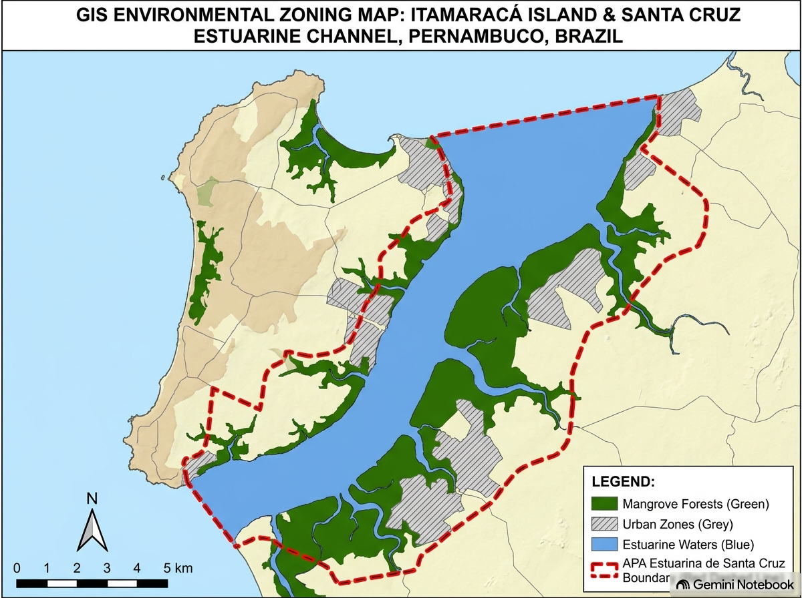

::: {.callout-note}
## Declaração de Uso de Ferramentas de IA
Este documento contou com o auxílio de inteligência artificial (Gemini Notebook) exclusivamente para suporte à revisão gramatical, formatação da linguagem Quarto (.qmd) e estruturação do texto, mantendo a integridade técnica do diagnóstico de campo e dos dados científicos do PIBIC UFPE elaborados pelo autor.
:::

## 1. Localização e Contexto Geográfico da Ilha de Itamaracá

A área selecionada como unidade de planejamento e proposta de intervenção ecológica abrange a **totalidade do território municipal da Ilha de Itamaracá**, compreendendo uma superfície insular de **8.311,91 hectares (83,12 km²)** no litoral norte do Estado de Pernambuco. O ecossistema insular é delimitado a leste pelo **Oceano Atlântico** e a oeste pela calha hídrica do **Canal de Santa Cruz**, estuário que separa a ilha do continente.

* **Unidade Territorial de Análise:** **Ilha de Itamaracá** em sua totalidade (área emersa insular, zona entremarés, faixa praiana e franja de manguezal estuarino).
* **Coordenadas Geográficas de Referência da Ilha (Ponto Central do Pilar):** **7°46'36.48" S** e **34°53'43.04" O** (Latitude: `-7.776800° S`; Longitude: `-34.895289° O`).
* **Inserção na Unidade de Conservação Regional:** A Ilha de Itamaracá está integralmente inserida na **Área de Proteção Ambiental (APA) Estuarina de Santa Cruz** (unidade de conservação estadual com **38.692,34 hectares totais**, regida pelo Decreto Estadual nº 32.488/2008), que atua como o arcabouço legal de gestão ambiental regional.
* **Sítio Focal de Intervenção e Amostragem Piloto:** Como recorte de amostragem direta e implantação das estruturas piloto de infraestrutura verde (wetlands e ecobarreiras), definiu-se um setor focal de **5,4 hectares** situado na orla periurbana do **Bairro do Pilar / Bairro Novo**, ao longo da margem estuarina do Canal de Santa Cruz (250 m de linha de orla por 70 m de largura de zona entremarés).
* **Bioma e Fitofisionomias Insulares:** A ilha pertence ao bioma **Mata Atlântica**, abrigando um mosaico vegetal composto por **manguezal estuarino** (*Rhizophora mangle*, *Avicennia schaueriana* e *Laguncularia racemosa*), vegetação de **restinga** costeira e remanescentes de **floresta estuarina e mata de encosta**.
* **Bacia Hidrográfica e Inserção Estuarina:** A ilha integra a bacia do **Canal de Santa Cruz (Grupo de Bacias GL-1)**, recebendo influência direta das águas continentais dos rios Botafogo, Igarassu e Maniquara, criando um gradiente microclimático e físico-químico único ao longo de toda a costa oeste da ilha.

---

## 2. Caracterização do Uso Atual e Histórico no Território Insular

* **Uso Histórico e Extrativismo Tradicional:** O território da Ilha de Itamaracá possui histórico centenário sustentado pelo **extrativismo da pesca artesanal de subsistência e comercialização local** (captura de moluscos e decápodes, com destaque para o siri-pimenta *Callinectes marginatus*), articulado pela Colônia de Pescadores Z-11 e marisqueiras dos bairros do Pilar, Jaguaribe, Forno da Cal e Forte Orange.
* **Dinâmica de Cobertura Vegetal na Ilha (MapBiomas 1985–2025):** A análise dos dados de sensoriamento remoto demonstra que o ecossistema estuarino da ilha apresentou resiliência biótica, registrando uma **recuperação de +13,81% na cobertura de floresta de mangue** nas últimas quatro décadas. Contudo, essa recuperação na calha estuarina contrasta com a degradação intensa das faixas de borda urbana.
* **Agentes Históricos e Atuais de Degradação na Ilha:**
  1. **Expansão Urbana Desordenada e Loteamentos de Veraneio:** Abertura de vias, aterro de franjas de mangue e restinga e construção de residências turísticas na orla, promovendo a fragmentação do habitat costeiro da ilha.
  2. **Lançamento de Efluentes e Lixo Urbano:** Ausência de sistema público de esgotamento sanitário nos bairros da ilha, resultando no descarte contínuo de esgoto doméstico *in natura* e resíduos plásticos nos canais e praias insulares.
  3. **Privatização da Orla e Pressão Antrópica:** Bloqueio de caminhos de acesso tradicional às praias por empreendimentos imobiliários e turismo náutico desordenado.
* **Situação Fundiária:** Terrenos públicos sob regime de Unidade de Conservação de Uso Sustentável (APA de Santa Cruz), Marinha e Áreas de Preservação Permanente (APP).

---

## 3. Diagnóstico Ecológico de Campo na Ilha de Itamaracá

* **Dinâmica Físico-Química e Gradiente de Salinidade:** As águas que circundam a ilha apresentam um gradiente espacial contínuo, partindo de médias de **21,89‰** nos canais estuarinos internos e elevando-se até **28,89‰** na foz do Canal de Santa Cruz e costa atlântica. A temperatura da água atinge picos de **32,79°C** nas zonas de menor circulação hídrica do interior do canal.
* **Cobertura Vegetal e Regeneração na Borda Insular:** A vegetação de manguezal e restinga ao longo da orla da ilha apresenta-se fragmentada por clareiras e pontos de aterro. A regeneração espontânea é limitada pela compactação do solo e acúmulo de resíduos sólidos nas raízes respiratórias.
* **Função de Berçário Estuarino e Fauna Recrutada:** Amostragens biológicas do PIBIC/UFPE comprovam que a costa oeste e os canais da Ilha de Itamaracá cumprem a função ecológica vital de **berçário estuarino** para populações de crustáceos e peixes. Na zona interna do canal, **77,78% das fêmeas e 67,51% dos machos de *Callinectes marginatus*** são indivíduos juvenis e imaturos que dependem da salubridade das margens da ilha para crescimento somático.

---

## 4. Diagnóstico do Contexto de Paisagem Insular

* **Matriz e Fragmentação:** A paisagem da Ilha de Itamaracá constitui um mosaico onde remanescentes de manguezal, restinga e mata atlântica interagem com uma **matriz urbana em expansão** (bairros do Pilar, Jaguaribe, Forte Orange e Vila Velha).
* **Conectividade Ecológica e Barreiras:** O Canal de Santa Cruz atua como corredor ecológico hídrico regional. Contudo, a poluição por esgoto e o acúmulo de plástico nas margens da ilha funcionam como barreiras químicas e físicas.
* **Mapeamento do Entorno:** Na escala insular, aproximadamente **40% do território compreende ecossistemas nativos preservados (mangue e corpos d'água)**, enquanto **60% corresponde a áreas urbanizadas, malha viária, solos expostos e áreas degradadas de borda**.

---

## 5. Classificação da Ilha como Ecossistema Híbrido

Com base na tipologia de Hobbs et al. (2006, 2014):
* **Classificação:** **Ecossistema Híbrido Insular**.
* **Justificativa Conceitual:** A Ilha de Itamaracá preserva a composição de espécies nativas e o papel funcional ecológico (berçário da fauna estuarina). Contudo, as condições abióticas originais do solo e da água foram alteradas de forma irreversível pela ocupação urbana e contaminação por efluentes domésticos, exigindo restauração assistida com infraestrutura verde.

---

## 6. Registros e Mapeamento de Campo

### Mapa de Localização Regional da Ilha de Itamaracá
{width=100%}

### Fotografias de Campo
*(Espaço reservado para as fotografias de campo reais da Ilha de Itamaracá)*

<!-- Para inserir suas fotos novas:
1. Salve as imagens na pasta raiz do seu projeto no RStudio.
2. Insira as linhas abaixo ajustadas com os nomes dos seus arquivos:

{width=48%}
{width=48%}
-->
