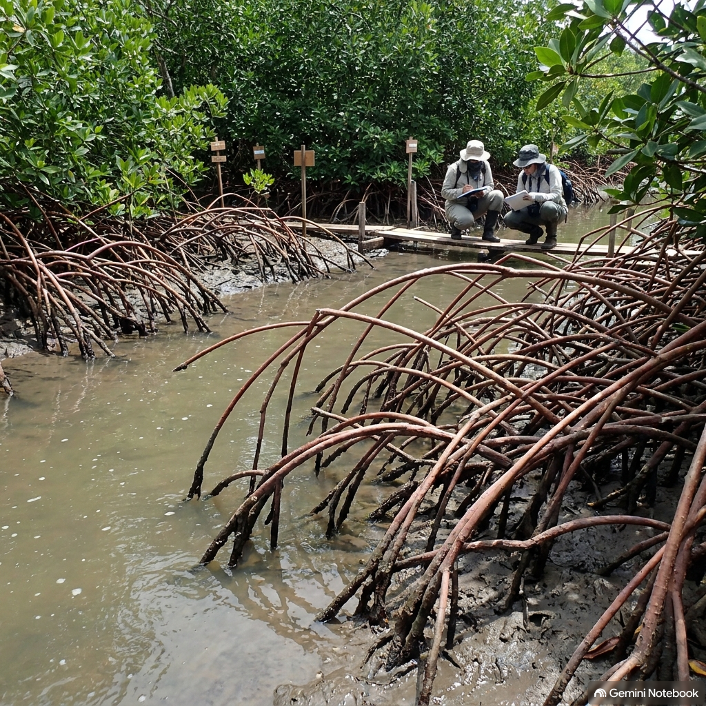
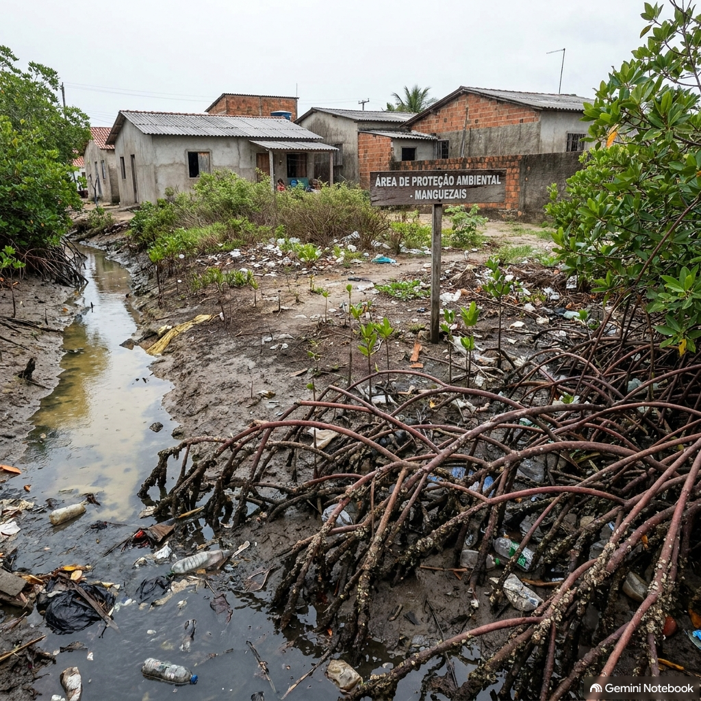

::: {.callout-note}
## Declaração de Uso de Ferramentas de IA
Este documento contou com o auxílio de inteligência artificial (Gemini Notebook) exclusivamente para suporte à revisão gramatical, formatação da linguagem Quarto (.qmd) e estruturação do texto, mantendo a integridade técnica do diagnóstico de campo e dos dados científicos do PIBIC UFPE elaborados pelo autor.
:::

## 1. Localização e Contexto Geográfico

A área selecionada para a proposta de intervenção e restauração ecológica localiza-se na margem do **Canal de Santa Cruz**, inserida na **Área de Proteção Ambiental (APA) Estuarina de Santa Cruz**, no litoral norte do Estado de Pernambuco. A unidade de conservação abrange uma superfície total de **24.943 hectares** e engloba territórios dos municípios de Itamaracá, Itapissuma e Goiana.

* **Coordenadas Geográficas de Referência (Ponto Central):** **7°46'36.48" S** e **34°53'43.04" O** (Latitude: `-7.776800° S`; Longitude: `-34.895289° O`).
* **Área Total do Sítio de Intervenção:** **5,4 hectares** (com extensão de perímetro aproximada de 1.150 metros ao longo da faixa de borda do manguezal e zona entremarés).
* **Bioma e Fitofisionomia Histórica Esperada:** O sítio pertence ao bioma **Mata Atlântica**, tendo como ecossistema nativo dominante o **manguezal estuarino** acompanhado por vegetação de ecótono e restinga. A fitofisionomia histórica esperada compreende florestas halófitas dominadas por espécies arbóreas nativas de mangue (*Rhizophora mangle*, *Avicennia schaueriana* e *Laguncularia racemosa*), fundamentais para a retenção de sedimentos, dissipação da energia de marés e manutenção da teia trófica estuarina.
* **Bacia Hidrográfica e Inserção Estuarina:** O sítio integra o sistema hídrico do **Canal de Santa Cruz**, sendo alimentado pelas bacias hidrográficas dos rios **Botafogo, Igarassu e Maniquara**. A coordenada geográfica selecionada localiza-se na zona estuarina interna do canal, próximo ao fluxo de drenagem do Rio Botafogo, sofrendo influência direta do aporte hídrico continental e do gradiente microclimático e físico-químico do estuário.

---

## 2. Caracterização do Uso Atual e Histórico

* **Uso Atual Dominante e Usos Anteriores:** O uso histórico e atual dominante da área é marcado pelo **extrativismo da pesca artesanal de subsistência e comercialização local** praticado por comunidades ribeirinhas e famílias de pescadores tradicionais. O sítio é intensamente utilizado para a captura de crustáceos decápodes — com destaque para o siri-pimenta (*Callinectes marginatus*) —, abastecendo tanto o consumo direto de subsistência familiar quanto a economia regional e pequenas indústrias e unidades familiares de beneficiamento de carne de siri e pescado.
* **Agentes Históricos e Atuais de Degradação:**
  1. **Expansão Urbana Desordenada e Impermeabilização:** A proximidade da APA com os núcleos urbanos e turísticos dos municípios de Itapissuma, Itamaracá e Goiana impulsionou a ocupação desordenada de margens, o aterro de manguezais e a perda de habitat nativo.
  2. **Lançamento de Efluentes e Xenobióticos:** A ausência e insuficiência de saneamento básico nas áreas periurbanas adjacentes resulta no descarte contínuo de esgoto doméstico *in natura*, resíduos sólidos (plásticos e entulho) e efluentes urbanos contendo poluição orgânica e xenobióticos na água e no sedimento estuarino.
  3. **Sobrepesca e Pressão Antrópica:** A exploração pesqueira constante, somada ao fluxo de turismo e navegação de pequeno porte, gera forte perturbação física e pressão sobre a estrutura populacional das espécies extrativas.
* **Impactos Socioeconômicos:** A contaminação por efluentes urbanos e a degradação da borda do manguezal comprometem diretamente a qualidade ambiental do berçário estuarino, reduzindo os estoques pesqueiros artesanais. Isso afeta diretamente a renda e a segurança alimentar de dezenas de famílias costeiras e reduz a oferta de matéria-prima para o setor local de beneficiamento.
* **Situação Fundiária:** **Área pública** sob regime de Unidade de Conservação de Uso Sustentável (APA Estuarina de Santa Cruz). Registram-se conflitos socioambientais territoriais derivados da sobreposição entre áreas de preservação permanente (APP), zonas de uso tradicional comunitário de pesca e o avanço da especulação imobiliária e ocupações urbanas informais.

---

## 3. Diagnóstico Ecológico de Campo

* **Recursos Hídricos e Dinâmica Físico-Química:**
  * O ecossistema estuarino apresenta um **gradiente espacial contínuo de salinidade**, partindo de médias de **21,89‰** nos canais internos (zona onde se insere a coordenada de intervenção) e elevando-se progressivamente até **28,89‰** na foz estuarina.
  * A temperatura da água no período estival atinge seu pico nas zonas internas do canal (**32,79°C** em E1 contra **30,22°C** na foz), acompanhada por um pH levemente alcalino e estável (entre **8,07 e 8,27**). A reduzida circulação hídrica no canal interno favorece o acúmulo de poluentes urbanos e efluentes domésticos.
* **Cobertura Vegetal Atual e Regeneração Natural:**
  * A vegetação de manguezal no entorno da coordenada apresenta-se **fragmentada**. Há trechos conservados com dossel arbóreo fechado intercalados por clareiras degradadas, pontos de solo exposto e áreas de borda impactadas por deposição de resíduos sólidos e aterros periféricos.
  * A regeneração natural espontânea de mudas nativas é limitada nas bordas devido à compactação do solo, sombreamento por resíduos e alteração do microclima e da hidrodinâmica estuarina.
* **Fauna e Grupos Funcionais:**
  * O sítio cumpre a função ecológica vital de **área de abrigo, alimentação e recrutamento de juvenis (berçário estuarino)** para espécies estuarinas e marinhas.
  * A amostragem biológica na zona interna do canal demonstra a dominância expressiva de **indivíduos juvenis e imaturos de decápodes (77,78% das fêmeas e 67,51% dos machos de *Callinectes marginatus*)**. Os organismos utilizam essa área protegida de menor salinidade para crescimento somático, realizando posteriormente migrações ontogenéticas para regiões externas de maior salinidade para maturação e desova.
* **Condição Aparente do Solo e Sedimento:** Sedimento lamoso estuarino característico de manguezal, apresentando áreas com acúmulo de resíduos plásticos, efluentes domésticos e contaminação por xenobióticos e matéria orgânica, gerando focos pontuais de anoxia.

---

## 4. Diagnóstico do Contexto de Paisagem

* **Matriz e Fragmentação:** A paisagem no raio do sítio constitui um mosaico ambiental onde fragmentos remanescentes de manguezal e restinga interagem com uma **matriz periurbana consolidada e em expansão** nos municípios de Itapissuma e Itamaracá.
* **Conectividade Ecológica e Barreiras:** O Canal de Santa Cruz é o principal corredor ecológico e hídrico regional que conecta as bacias fluviais ao oceano. No entanto, a poluição por efluentes urbanos, o lançamento de xenobióticos e a ocupação das margens funcionam como **barreiras químicas e físicas** que prejudicam a movimentação migratória da fauna e o fluxo de propágulos.
* **Entorno Imediato (Raio de 1 km):** A análise do raio de 1 km no entorno da coordenada indica que aproximadamente **40% da área é composta por manguezal nativo e corpos d'água estuarinos**, enquanto os **60% restantes compreendem áreas edificadas, malha viária, infraestrutura urbana e áreas degradadas com perda de vegetação**.

---

## 5. Classificação Preliminar do Ecossistema

Com base na tipologia conceitual de ecossistemas segundo Hobbs et al. (2006, 2014) abordada na disciplina:

* **Classificação:** **Ecossistema Híbrido**.
* **Justificativa Conceitual:** O sítio preserva a composição de espécies e funções ecológicas nativas fundamentais — como a presença das espécies de mangue nativas e o papel crucial de berçário para a fauna de invertebrados e peixes. Contudo, as condições abióticas originais do ambiente foram substancialmente alteradas pela poluição por xenobióticos, despejo de efluentes domésticos e modificação do uso do solo urbano no entorno imediato.

---

## 6. Registros e Mapeamento de Campo

### Mapa de Localização
*(Substitua o arquivo da imagem abaixo pelo mapa exportado do QGIS ou Google My Maps)*

{width=100%}

### Fotografias de Campo
*(Adicione aqui suas 5 fotos de campo)*

{width=48%}
{width=48%}
