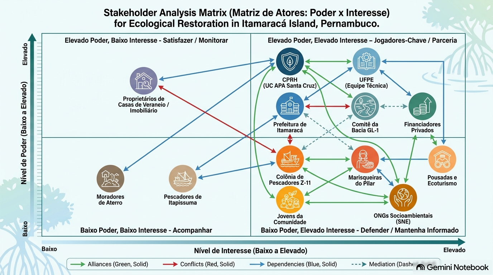

::: {.callout-note}
## Declaração de Uso de Ferramentas de IA e Estrutura do Documento
Este documento integra o **Exercício 2 — Atores, poder e justiça no planejamento da restauração** da disciplina de Ecologia da Restauração (UFPE). O texto contou com o auxílio do Gemini Notebook exclusivamente para suporte à formatação da linguagem Quarto (.qmd) e revisão ortográfica, mantendo-se a autoria, os dados de campo do PIBIC UFPE e a fundamentação teórica de ecologia política elaborada pelo autor.
:::

## Parte 1 — Delimitação da Área e Premissas

### Unidade de Restauração e Contexto Geográfico
A unidade de planejamento abrange a totalidade do território municipal da **Ilha de Itamaracá** (**8.311,91 hectares** no recorte insular), integralmente inserida na **Área de Proteção Ambiental (APA) Estuarina de Santa Cruz** (unidade de conservação estadual com **38.692,34 hectares totais**, sendo 24.943 ha continentais e 13.749 ha marinhos). A ilha é banhada a oeste pelo **Canal de Santa Cruz** e a leste pelo **Oceano Atlântico**. 

Dentro do ecossistema insular, o ponto focal de amostragem e intervenção piloto situa-se na orla periurbana do **Bairro do Pilar / Bairro Novo** (coordenadas centrais: **7°44'50" S** e **34°50'25" O**), abrangendo um setor de **5,4 hectares** de borda estuarina (250 m de orla por 70 m de largura de zona entremarés e ecótono). O sítio conecta-se à **Bacia Hidrográfica do Rio Goiana e pequenos rios litorâneos (Grupo de Bacias GL-1)**, recebendo vazão hídrica continental dos rios Botafogo, Igarassu e Maniquara. A fitofisionomia nativa de referência pertence ao bioma **Mata Atlântica**, dominada por manguezal estuarino (*Rhizophora mangle*, *Avicennia schaueriana* e *Laguncularia racemosa*), intercalado por formações de restinga.

### Premissas Adotadas sobre o Cenário
* **Regime de Posse da Terra e Situação Fundiária:** Área pública sob regime de Unidade de Conservação de Uso Sustentável (APA Estuarina de Santa Cruz, Decreto Estadual nº 32.488/2008). A faixa costeira enquadra-se como Terrenos de Marinha e Áreas de Preservação Permanente (APP, Lei nº 12.651/2012). No zoneamento da CPRH, a orla periurbana sobrepõe a **Subzona Urbano-Turística** a **Áreas para Recuperação e Conservação (ARC)** e **Áreas Preferenciais para Preservação (APR)**.
* **Histórico de Uso da Terra:** Uso centenário de **extrativismo da pesca artesanal de subsistência e comercialização local** (captura de decápodes, com destaque para o siri-pimenta *Callinectes marginatus*). Nas últimas quatro décadas, o uso do solo combinou a recuperação espontânea do manguezal na calha estuarina (+13,81% de cobertura florestal pelo MapBiomas, 1985–2025) com a expansão urbana desordenada de borda.
* **Fontes de Financiamento Esperadas:** Arranjo misto de Recursos de Compensação Ambiental (SEUC / CPRH) do Polo Automotivo de Goiana e Complexo de Itapissuma, Fundos Públicos de Meio Ambiente (FEMA/PE e FNMA/MMA) e Parcerias Público-Privadas com o setor hoteleiro/turístico da ilha.
* **Organização Social e Conflitos:** Presença da **Colônia de Pescadores Z-11** e grupos informais de marisqueiras do Pilar. Conflitos envolvendo privatização e bloqueio do acesso público à praia por loteamentos de veraneio, contaminação do berçário por esgoto *in natura* e efluentes, e sobrepesca.

### Escalas de Atuação e Articulação
* **Escala Local / Comunitária:** Bairros periurbanos de Itamaracá (Pilar, Jaguaribe, Vila Velha, Forno da Cal, Forte Orange); pescadores da Colônia Z-11, marisqueiras informais e moradores.
* **Escala Municipal / Regional:** Prefeitura de Itamaracá, Prefeituras de Itapissuma e Goiana, Conselho Gestor da APA de Santa Cruz (CPRH) e Comitê da Bacia GL-1.
* **Escala Estadual / Nacional:** CPRH, SEMAS/PE, UFPE (monitoramento biológico) e Ministério do Meio Ambiente (MMA).
* **Escala Global:** Padrões Internacionais da *Society for Ecological Restoration* (SER) e Metas de Kunming-Montreal (CDB/ONU).

---

## Parte 2 — Levantamento e Caracterização dos Atores Socioambientais

A Tabela 1 apresenta o cadastramento sistemático de **14 atores reais do território**, categorizados segundo a Ecologia Política de Bryant & Bailey (1997) e distribuídos em 4 escalas de atuação, evidenciando as distinções entre atores *estabelecidos* e *interessados*.

### Tabela 1: Levantamento completo dos atores socioambientais (Bryant & Bailey, 1997).

| Ator | Categoria (Bryant & Bailey, 1997) | Escala | Estabelecido / Interessado | Interesse Principal na Área / Projeto | Recursos que Mobiliza | Posição Estimada |
| :--- | :--- | :--- | :--- | :--- | :--- | :--- |
| **1. Colônia de Pescadores Z-11 (Liderança e Pescadores)** | Atores de Base (Organizado) | Local / Municipal | Estabelecido | Manutenção dos estoques pesqueiros, livre navegação no canal e locais de acostagem. | Conhecimento Ecológico Tradicional (TEK), capacidade de mobilização e barcos. | Apoia com condições (exige manutenção da pesca artesanal). |
| **2. Grupo Informal de Marisqueiras da Orla do Pilar** | Atores de Base (Grupo de Gênero) | Local | Estabelecido | Garantia de renda de subsistência, salubridade da água e despoluição dos bancos de marisco. | Conhecimento prático intensivo sobre o manguezal, trabalho manual diário de catação. | Apoia fortemente (exige remuneração e representação direta). |
| **3. Jovens e Filhos de Pescadores (Pilar e Jaguaribe)** | Atores de Base (Recorte de Geração) | Local | Estabelecido | Oportunidades de trabalho local, bolsas de monitoramento e capacitação em ecoturismo. | Mão de obra jovem, dinamismo e facilidade com tecnologias digitais/aplicativos. | Apoia (condicionado à criação de vagas e bolsas remuneradas). |
| **4. Moradores de Ocupações Periurbanas (Aterros/APP)** | Atores de Base (População Vulnerável) | Local | Estabelecido | Regularização de saneamento, drenagem e proteção contra erosão e remoções habitacionais. | Presença física contínua no território e representação política comunitária. | Resistente/Desconfiado (teme remoções habitacionais). |
| **5. Proprietários de Casas de Veraneio / Setor Imobiliário** | Empresas / Setor Imobiliário | Municipal / Regional | Estabelecido | Valorização imobiliária, balneabilidade da água e privacidade nas bordas de praia. | Capital financeiro expressivo, influência política local e assessoria jurídica. | Apoia condicionalmente (opõe-se a caminhos públicos defronte às casas). |
| **6. Prefeitura Municipal de Itamaracá (Meio Ambiente e Obras)** | Estado | Municipal | Estabelecido | Valorização turística, atração de recursos, adequação ao plano diretor e limpeza pública. | Poder fiscalizador municipal, alvarás, maquinário de obras e limpeza urbana. | Apoia (desde que não exija grandes aportes do tesouro municipal). |
| **7. Agência Estadual de Meio Ambiente (CPRH - Gestão APA)** | Estado | Estadual | Estabelecido | Cumprimento do Plano de Manejo da APA, proteção de APPs e zoneamento ambiental (ARC/APR). | Poder de polícia ambiental, licenciamento, fiscalização e compensação ambiental. | Apoia institucionalmente (exige rigor no licenciamento simplificado). |
| **8. Comitê da Bacia Hidrográfica do Grupo de Rios GL-1** | Estado / Instância Participativa | Regional / Estadual | Estabelecido | Redução da carga poluidora no Canal de Santa Cruz e promoção de SbN na bacia hidrográfica. | Legitimidade na alocação de recursos de cobrança de água e articulação regional. | Apoia entusiasticamente (modelo piloto para réplica na bacia). |
| **9. Universidade Federal de Pernambuco (UFPE / PIBIC)** | Academia / Consultoria Técnica | Estadual / Nacional | Estabelecido / Interessado | Produção científica, monitoramento do siri-pimenta (*Callinectes marginatus*) e validação técnica. | Conhecimento científico especializado, prestígio e redes de amostragem de campo. | Apoia com liderança técnica (garante o rigor científico). |
| **10. Associação de Hotéis e Pousadas de Itamaracá** | Empresas | Municipal / Regional | Estabelecido | Fortalecimento do ecoturismo sustentável e melhoria da imagem ambiental da ilha. | Estrutura receptiva, divulgação comercial e conexão com o mercado turístico. | Apoia (busca integrar circuitos ecológicos nos pacotes locais). |
| **11. Empresas do Polo Automotivo e Industrial (Goiana/Itapissuma)** | Empresas (Setor Privado) | Regional / Estadual | Interessado | Cumprimento de obrigações de Licenciamento Ambiental e TACs via Compensação (SEUC). | Elevado aporte de capital financeiro privado para financiamento do projeto. | Apoia como Financiador (busca metas ESG e abatimento legal). |
| **12. Fundo Estadual de Meio Ambiente (FEMA / SEMAS-PE)** | Financiador Público | Estadual | Interessado | Execução de políticas de restauração em Unidades de Conservação com retorno social. | Recursos públicos estaduais não-reembolsáveis através de editais ambientais. | Financiador em Potencial (exige salvaguardas sociais e metas SER). |
| **13. Sociedade Nordestina de Ecologia (SNE) / ONGs** | Organizações Não Governamentais | Regional / Nacional | Interessado | Conservação da Mata Atlântica/manguezal, justiça ambiental e proteção comunitária. | Captação de recursos internacionais, assessoria jurídica e auditoria independente. | Apoia e Audita (atua como observadora contra o greenwashing). |
| **14. Catadores de Caranguejo e Pescadores de Itapissuma** | Atores de Base (Vizinhos) | Regional / Intermunicipal | Estabelecido | Manutenção do livre trânsito de barcos no Canal de Santa Cruz e acesso aos bancos de catação. | Uso prático do canal hídrico e rede de solidariedade intermunicipal de pesca. | Neutro com Preocupação (exige que biofiltros não fechem o canal). |

---

## Parte 3 — Classificação do Poder e Mapa de Atores

### Fichas Analíticas dos 6 Atores Centrais

#### Ficha 1: Colônia de Pescadores e Aquicultores Z-11
* **Modo(s) de poder (Wolf, 1990):** **Atributo** (posse do Conhecimento Ecológico Tradicional - TEK sobre marés e fauna) e **Relacional** (capacidade de vetar localmente ações que bloqueiem a navegação).
* **Dimensão de poder (Lukes, 1974):** **1ª Dimensão (Decisão Observável)** — Atua diretamente em reuniões e conflitos abertos sobre regras de uso da água e pontos de acostagem.
* **Mecanismos de acesso (Ribot & Peluso, 2003):** Acesso baseado em **conhecimento**, **identidade cultural tradicional** e **redes sociais locais**; possui fraco acesso ao capital financeiro e à autoridade legal formal.
* **Poder, legitimidade e urgência (Mitchell et al., 1997):** **Ator Dependente** (*Legitimidade + Urgência, sem Poder Estrutural*) \(\rightarrow\) Alta legitimidade histórica, dependendo de alianças formais para fazer valer suas demandas.

#### Ficha 2: Grupo Informal de Marisqueiras da Orla do Pilar
* **Modo(s) de poder (Wolf, 1990):** **Atributo reduzido** (trabalho manual intensivo na zona entremarés) e **ausência de poder tático ou estrutural** (invisibilizadas nos espaços formais de tomada de decisão).
* **Dimensão de poder (Lukes, 1974):** **3ª Dimensão (Formação de Preferências)** — Internalização da exclusão, em que a contaminação por esgoto é frequentemente aceita como 'condição natural' do trabalho na borda urbana.
* **Mecanismos de acesso (Ribot & Peluso, 2003):** Acesso baseado no **trabalho físico diário** e **conhecimento prático**; desprovidas de direitos formais de propriedade e acesso direto a mercados (dependem de atravessadores).
* **Poder, legitimidade e urgência (Mitchell et al., 1997):** **Ator Exigente / Vulnerável** (*Legitimidade + Urgência, sem Poder*) \(\rightarrow\) Alta urgência pela despoluição, exigindo mecanismos afirmativos de inclusão no projeto.

#### Ficha 3: Agência Estadual de Meio Ambiente de Pernambuco (CPRH)
* **Modo(s) de poder (Wolf, 1990):** **Estrutural** (poder de ditar as leis e o Plano de Manejo) e **Tático/Organizacional** (controla os ritos e agendas do Conselho da APA).
* **Dimensão de poder (Lukes, 1974):** **2ª Dimensão (Controle da Agenda)** — Define quais pautas entram na ordem do dia e quais empreendimentos serão fiscalizados.
* **Mecanismos de acesso (Ribot & Peluso, 2003):** Acesso baseado na **Autoridade Legal**, **Direitos Formais** e **Controle Institucional** sobre a unidade de conservação.
* **Poder, legitimidade e urgência (Mitchell et al., 1997):** **Ator Dominante** (*Poder + Legitimidade legal*) \(\rightarrow\) Prerrogativa jurídica incontestável sobre a APA de Santa Cruz.

#### Ficha 4: Prefeitura Municipal da Ilha de Itamaracá
* **Modo(s) de poder (Wolf, 1990):** **Tático/Organizacional** (controle sobre o uso do solo urbano, alvarás de construção, limpeza e obras públicas).
* **Dimensão de poder (Lukes, 1974):** **1ª e 2ª Dimensões** — Decide abertamente sobre a alocação de saneamento e omite-se (não-decisão) na fiscalização de aterros praticados por veranistas.
* **Mecanismos de acesso (Ribot & Peluso, 2003):** Acesso baseado na **Autoridade Política Local**, **Infraestrutura Pública** e **Recursos Orçamentários Municipais**.
* **Poder, legitimidade e urgência (Mitchell et al., 1997):** **Ator Dominante** (*Poder + Legitimidade política local*) \(\rightarrow\) Capacidade de viabilizar ou bloquear obras na zona urbana.

#### Ficha 5: Proprietários de Casas de Veraneio / Setor Imobiliário Privado
* **Modo(s) de poder (Wolf, 1990):** **Atributo** (elevado capital financeiro) e **Tático** (influência política direta e acesso a assessorias jurídicas privadas).
* **Dimensão de poder (Lukes, 1974):** **2ª Dimensão (Controle da Agenda)** — Consegue barrar a criação de acessos públicos à beira-mar defronte às suas propriedades.
* **Mecanismos de acesso (Ribot & Peluso, 2003):** Acesso baseado no **Capital**, **Mercados Imobiliários** e **Direitos Formais/Informais de Propriedade Privatizada**.
* **Poder, legitimidade e urgência (Mitchell et al., 1997):** **Ator Discrecionário / Potencialmente Perigoso** (*Elevado poder econômico sem urgência social*) \(\rightarrow\) Pode embargar juridicamente as intervenções na orla.

#### Ficha 6: Universidade Federal de Pernambuco (UFPE / PIBIC)
* **Modo(s) de poder (Wolf, 1990):** **Atributo** (prestígio acadêmico) e **Tático** (capacidade de estruturar o projeto de restauração e definir indicadores de sucesso).
* **Dimensão de poder (Lukes, 1974):** **2ª Dimensão (Controle da Agenda Técnica)** — Determina quais indicadores biológicos (*Callinectes marginatus*) e técnicas serão considerados válidos.
* **Mecanismos de acesso (Ribot & Peluso, 2003):** Acesso baseado no **Conhecimento Científico Especializado**, **Tecnologia de Monitoramento** e **Redes de Financiamento Acadêmico**.
* **Poder, legitimidade e urgência (Mitchell et al., 1997):** **Ator Dominante / Intermediário** (*Legitimidade Científica + Poder Técnico*) \(\rightarrow\) Atua como ponte entre a comunidade e os órgãos financiadores.

---

### Figura do Mapa de Atores (Matriz Poder x Interesse)

A Figura 1 posiciona os 14 atores nos 4 quadrantes da Matriz de Análise de Atores (Poder \(\times\) Interesse) e ilustra os vetores de relação socioambiental no território da Ilha de Itamaracá.

{width=100%}

#### Análise dos Vetores de Relação Mapeados na Figura 1:
* **Vetores Verdes de Aliança (Cooperação):** Conectam a `UFPE`, a `Colônia Z-11` e as `Marisqueiras` na defesa da despoluição do estuário e no monitoramento participativo do siri-pimenta (*Callinectes marginatus*).
* **Vetores Vermelhos de Conflito (Tensão):** Representam os atritos históricos entre os `Extrativistas Tradicionais` e os `Proprietários de Veraneio` (causados por esgoto privado, aterros de mangue e bloqueio de acessos à praia).
* **Vetores Azuis de Dependência:** Indicam a subordinação dos pescadores e marisqueiras às licenças ambientais da `CPRH` e às obras de saneamento da `Prefeitura`.
* **Vetores Pontilhados de Intermediação:** A `UFPE` e o `Comitê GL-1` atuam como mediadores técnicos para captar recursos junto aos financiadores públicos (`FEMA`) e privados (`Polo Industrial de Goiana`).

---

## Parte 4 — Análise das Assimetrias de Poder

A Tabela 2 detalha 5 assimetrias centrais de poder identificadas no território, classificando-as segundo as dimensões de Justiça Ambiental de Schlosberg (2007) (*Distributiva, de Reconhecimento e Procedimental*) e contemplando recortes obrigatórios de **gênero**, **geração** e **diferença de escala**.

### Tabela 2: Matriz de assimetrias de poder e dimensões da justiça ambiental.

| Assimetria Identificada | Atores Envolvidos | Mecanismo de Poder / Exclusão | Dimensão da Justiça Afetada (Schlosberg, 2007) | Impacto no Planejamento |
| :--- | :--- | :--- | :--- | :--- |
| **1. Assimetria de Gênero e Invisibilidade do Trabalho** | Marisqueiras do Pilar *vs.* Liderança da Colônia Z-11 | Marisqueiras exercem trabalho manual intensivo no esgoto, mas as reuniões decisórias são dominadas por homens pescadores de embarcação. | **Reconhecimento / Procedimental** | Riscos de o projeto priorizar apetrechos de pesca de calha e ignorar a salubridade dos bancos de catação de marisco. |
| **2. Assimetria de Geração e Exclusão de Jovens** | Jovens/Filhos de Pescadores *vs.* Gestores Institucionais | Jovens sem acesso a bolsas formais ou capacitação técnica são tratados apenas como mão de obra não-qualificada, impulsionando o exodo urbano. | **Distributiva / Reconhecimento** | Perda de engajamento contínuo e falta de renovação do conhecimento tradicional de gestão do manguezal. |
| **3. Diferença de Escala e Centralização Decisória** | CPRH / Prefeitura *vs.* Colônia Z-11 e Marisqueiras | Ritos burocráticos e reuniões técnicas agendadas na capital (Recife) em horários incompatíveis com a rotina de maré de catação. | **Procedimental** | Esvaziamento da participação comunitária direta, transformando consultas em meras homologações formais. |
| **4. Assimetria Econômico-Fundiária e Privatização da Orla** | Proprietários de Veraneio *vs.* Pescadores Artesanais | Fechamento físico de servidões tradicionais de passagem para a praia por muros privados de casas de veraneio. | **Distributiva / Reconhecimento** | Bloqueio do acesso livre de marisqueiras aos bancos de catação e perda de locais tradicionais de acostagem de barcos. |
| **5. Assimetria de Capital Financeiro e Compensação** | Polo Industrial de Goiana/Itapissuma *vs.* Comunidade Local | Empresas poluidoras cumprem TACs pagando compensação ambiental ao Estado sem que o recurso retorne em saneamento básico para a comunidade da ilha. | **Distributiva** | Manutenção da poluição estuarina por esgoto enquanto grandes empreendimentos obtêm regularização ambiental. |

---

## Parte 5 — Riscos de Manutenção ou Criação de Injustiças no Ciclo do Projeto

A Tabela 3 analisa os riscos de geração ou aprofundamento de injustiças socioambientais ao longo de cada etapa do ciclo de vida da restauração ecológica.

### Tabela 3: Análise de riscos de injustiça ao longo do ciclo de vida da restauração.

| Etapa do Ciclo do Projeto | Injustiça Potencial / Risco Mapeado | Vítimas Principais | Tipo de Justiça Comprometida |
| :--- | :--- | :--- | :--- |
| **1. Diagnóstico Inicial** | Uso exclusivo de dados científicos acadêmicos desconsiderando o Conhecimento Ecológico Tradicional (TEK) sobre manchas de poluição. | Marisqueiras e Pescadores Tradicionais | **Reconhecimento** |
| **2. Definição de Metas** | Estabelecimento de metas focadas apenas na cobertura florestal sem incluir metas sanitárias ou de produtividade do berçário pesqueiro. | Comunidade Extrativista Local | **Distributiva** |
| **3. Escolha de Técnicas** | Proposta de cercamento total ou interdição de trechos de manguezal, impedindo o acesso tradicional de catação de marisco. | Marisqueiras do Pilar e Jaguaribe | **Distributiva / Procedimental** |
| **4. Contratação e Execução** | Importação de empreiteiras externas para montagem dos biofiltros, usando a comunidade apenas como mão de obra voluntária não-remunerada. | Trabalhadores e Jovens Locais | **Distributiva** |
| **5. Monitoramento** | Centralização das análises em laboratórios universitários sem devolução dos resultados em linguagem acessível para a comunidade. | População Residente | **Procedimental** |
| **6. Pós-Financiamento** | Encerramento das verbas sem transferência de autonomia, deixando o custo de manutenção das ecobarreiras sobre a Colônia Z-11. | Colônia Z-11 e Marisqueiras | **Distributiva** |

---

## Parte 6 — Medidas Corretivas Incorporadas ao Desenho do Projeto

Para neutralizar os riscos e corrigir as assimetrias mapeadas, o projeto incorpora **5 medidas corretivas vinculantes**, com detalhamento de arranjo institucional, garantias financeiras e indicadores de acompanhamento (Tabela 4).

### Tabela 4: Quadro de medidas corretivas, orçamento e garantias institucionais.

| Medida Corretiva Incorporada | Arranjo Institucional e Garantia | Orçamento Alocado | Nível na Escada de Arnstein (1969) | Indicador de Acompanhamento |
| :--- | :--- | :--- | :--- | :--- |
| **1. Paridade de Gênero na Co-gestão** | Criação do Comitê Local com **50% das cadeiras reservadas para o Grupo de Marisqueiras** e direito a voto deliberativo. | R$ 6.000,00 (Apoio logístico às reuniões) | **Parceria / Controle Cidadão** (Nível 6-8) | % de mulheres marisqueiras com presenças registradas em ata. |
| **2. Remuneração Obrigatória do Trabalho Local** | Cláusula contratual vinculante destinando **no mínimo 35% do orçamento para pagamento de diárias** a pescadores e marisqueiras. | R$ 25.900,00 (Diárias e mão de obra local) | **Poder Cidadão / Parceria** (Nível 6) | % do orçamento direto pago a trabalhadores residentes locais (Meta >35%). |
| **3. Programa de Bolsas de Monitoramento Jovem** | Criação de 6 bolsas de Monitoramento Comunitário (PIBIC-Comunitário) para jovens auxiliarem a UFPE na amostragem biológica. | R$ 14.400,00 (6 bolsas de R$ 200/mês por 12 meses) | **Parceria / Co-gestão** (Nível 6) | 6 jovens capacitados produzindo relatórios trimestrais comunitários. |
| **4. Cartografia Participativa de Servidões de Acesso** | Mapeamento e tombamento comunitário dos caminhos de praia no Plano de Manejo da APA, garantindo passagem livre. | R$ 5.000,00 (Oficinas e sinalização) | **Poder Cidadão / Controle** (Nível 7-8) | 100% dos caminhos tradicionais de marisqueiras demarcados e protegidos. |
| **5. Fundo Comunitário de Manutenção (Pós-Projeto)** | Reversão de 10% dos recursos de compensação ambiental para Fundo gerido pela Colônia Z-11 para manutenção pós-Ano 5. | R$ 7.400,00 (Aporte inicial de reserva) | **Controle Cidadão Autônomo** (Nível 8) | Saldo em caixa e nº de mutirões de manutenção executados pós-Ano 5. |

---

## Parte 7 — Síntese Crítica (Ecologia Política e Restauração)

O Projeto de Intervenção em Área Degradada (PAD) na Ilha de Itamaracá **não se limita a administrar o poder existente de forma mais cuidadosa; ele promove uma redistribuição estrutural e real de poder no território estuarino**. Ao condicionar a execução da restauração a cláusulas orçamentárias vinculantes que destinam no mínimo **35% dos recursos diretamente para a remuneração das marisqueiras e pescadores**, o projeto retira a restauração do campo do 'trabalho voluntário benevolente' e a insere na economia formal de serviços ambientais. Além disso, a garantia institucional de **50% de cadeiras deliberativas para as mulheres marisqueiras** no Comitê Local rompe a hegemonia histórica masculina nas decisões pesqueiras da Colônia Z-11, elevando a participação comunitária ao nível de *Parceria e Controle Cidadão* (Arnstein, 1969).

A assimetria mais difícil de corrigir dentro do alcance do projeto é a **injustiça distributiva derivada do déficit histórico de saneamento básico urbano e da especulação imobiliária**. Como o projeto de restauração não possui prerrogativa constitucional para executar obras de macrodrenagem e estações de tratamento de esgoto de grande porte — atribuição da COMPESA e da Prefeitura Municipal —, a contaminação por efluentes domésticos só pode ser mitigada localmente pelas *wetlands* construídas. O poder econômico dos proprietários de casas de veraneio e loteamentos beira-mar, amparado por assessorias jurídicas privadas, impõe barreiras judiciais à despropriação de áreas aterradas, demonstrando os limites do poder tático de um projeto socioambiental frente ao poder estrutural do capital imobiliário (Wolf, 1990; Lukes, 1974).

A principal lacuna da análise reside em não ter ouvido diretamente os **proprietários de loteamentos de veraneio e os empreendedores turísticos informais**, cujas visões foram reconstituídas a partir de dados secundários do Plano de Manejo da APA. Essa ausência limita a capacidade de antecipar estratégias de contestação jurídica contra o tombamento dos caminhos de acesso à praia.

Finalmente, a análise socioeconômica alterou profundamente o desenho ecológico original do projeto (Exercício 1): **abandonou-se qualquer proposta de plantio uniforme e fechamento total de áreas de manguezal em favor de uma restauração assistida por nucleação e desobstrução hidrológica**, garantindo que a regeneração das espécies nativas (*Rhizophora mangle*) aconteça sem interditar as rotas de navegação e os bancos tradicionais de catação de marisco da Ilha de Itamaracá.
