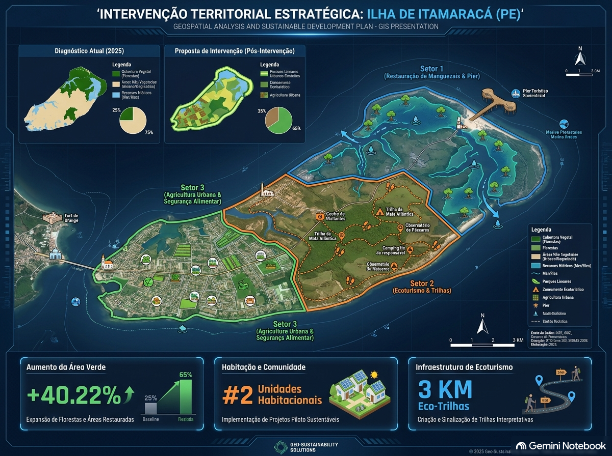

::: {.callout-note}
## Declaração de Uso de Ferramentas de IA
Este documento contou com o auxílio de ferramenta de inteligência artificial exclusivamente para suporte à formatação na linguagem Quarto (.qmd) e revisão ortográfica, mantendo-se integralmente a autoria, a fundamentação científica e os dados originais do diagnóstico de campo e do PIBIC UFPE.
:::

## 1. Detalhamento das Técnicas e Ações de Intervenção

Considerando a classificação da Ilha de Itamaracá como um **Ecossistema Híbrido com alta resiliência biótica** (Hobbs et al., 2006; Suganuma & Durigan, 2018), as intervenções operacionais priorizam a **mitigação de estressores abióticos** e a **restauração assistida**, dispensando plantios homogêneos de grande escala em favor de soluções baseadas na natureza (SbN).

### 1.1 Solução de Infraestrutura Verde: Wetlands Construídas (Biofiltros)
* **Objetivo:** Tratar efluentes sanitários domésticos *in natura* descarregados diretamente nos canais estuarinos da orla periurbana.
* **Metodologia:** Instalação de sistemas de alagados construídos de fluxo subsuperficial horizontal localizados na zona de transição urbano-mangue.
* **Mecanismo Ecológico:** O efluente passa por leito filtrante de brita e areia cultivado com macrófitas aquáticas nativas (*Typha domingensis* e *Cyperus papyrus*). As raízes promovem a oxigenação do meio e a remoção de matéria orgânica (redução de 80-90% da DBO), nutrientes (N e P) e coliformes por assimilação biológica e filtragem física, eliminando os focos de anoxia no sedimento de mangue.

### 1.2 Controle Mecânico de Contaminação: Ecobarreiras Flutuantes Comunitárias
* **Objetivo:** Interceptar e reter resíduos sólidos urbanos (macroplásticos, garrafas PET, embalagens) transportados pela drenagem urbana e pelas marés antes da sua fixação no sistema radicular de *Rhizophora mangle*.
* **Metodologia:** Montagem de barreiras flutuantes utilizando galões plásticos reutilizados de 20L interligados por redes de alta resistência, ancoradas nas fozes dos principais canais de drenagem urbana.
* **Operacionalização:** Coleta e triagem semanal dos resíduos retidos realizada em parceria com a Colônia de Pescadores Z-11 e cooperativas locais de catadores, destinando o plástico para reciclagem.

### 1.3 Restauração Assistida e Manejo da Vegetação Halófita
* **Objetivo:** Desobstruir o fluxo hídrico e restabelecer a hidrodinâmica entremarés para favorecer a dispersão e o recrutamento espontâneo de propágulos nativos.
* **Ações:**
  1. **Desobstrução de Canais de Maré:** Remoção manual de entulhos e sedimentos compactados que impedem o fluxo de maré em clareiras de borda.
  2. **Nucleação com Módulos de Bambu (Protetores de Propágulos):** Em trechos de borda sujeitos a forte erosão por marés ou pisoteio, instalaremos pequenos núcleos de estacas de bambu para retenção física de propágulos de *Rhizophora mangle*, *Avicennia schaueriana* e *Laguncularia racemosa* trazidos naturalmente pelas águas.

---

### Mapeamento da Proposta de Intervenção
{width=100%}

## 2. Cronograma Operacional Graduado (Anos 1 a 10)

O plano de ação está estruturado em quatro fases graduadas para assegurar a sustentabilidade técnica e social ao longo de uma década:

| Fase | Período | Ações Principais | Metas de Curto/Longo Prazo |
| :--- | :---: | :--- | :--- |
| **Fase 1: Mobilização e Licenciamento** | Ano 1 | Mobilização comunitária, criação do Comitê de Bacia/APA e licenciamento ambiental Simplificado junto à CPRH. | 100% dos atores mapeados formalizados; licença concedida. |
| **Fase 2: Implantação de Infraestrutura** | Anos 1–2 | Construção das wetlands piloto e instalação das 4 ecobarreiras prioritárias na orla. | Intercepção de 80% do lixo flutuante; início do tratamento de efluentes. |
| **Fase 3: Restauração Assistida e Manejo** | Anos 2–5 | Desobstrução hidrológica e instalação de núcleos de retenção de propágulos nas clareiras. | Recuperação do dossel em 50% das clareiras identificadas. |
| **Fase 4: Consolidação e Monitoramento** | Anos 5–10 | Monitoramento da qualidade da água, estoque do berçário de *Callinectes marginatus* e transferência de gestão. | Cobertura florestal mantida >30%; autonomia da comunidade na manutenção. |

---

## 3. Análise de Viabilidade Financeira e Orçamento Discriminado

A opção por soluções baseadas na natureza e restauração assistida reduz drasticamente os custos quando comparada a projetos tradicionais de engenharia dura e plantio total.

### Orçamento Estimativo de Implantação e Manutenção (Ciclo de 5 Anos)

| Item / Categoria | Descrição / Especificação | Quantidade / Unidade | Custo Unitário (R$) | Custo Total (R$) |
| :--- | :--- | :---: | :---: | :---: |
| **Insumos para Biofiltros** | Brita, areia, tubulações de PVC, geomembrana impermeabilizante e mudas de macrófitas. | 2 unidades piloto | R$ 12.000,00 | R$ 24.000,00 |
| **Materiais para Ecobarreiras** | Galões de 20L, cordas de polietileno, redes de pesca recicladas e poitas de concreto. | 4 unidades | R$ 1.500,00 | R$ 6.000,00 |
| **Mão de Obra Local** | Contratação de pescadores e moradores para montagem e manutenção (diárias). | 120 diárias / ano | R$ 150,00 | R$ 18.000,00 |
| **Módulos de Nucleação** | Estacas de bambu e amarras biodegradáveis para retenção de propágulos. | 50 núcleos | R$ 60,00 | R$ 3.000,00 |
| **Equipamentos de Proteção (EPIs)** | Botas de borracha, luvas reforçadas e coletes salva-vidas. | 20 kits | R$ 250,00 | R$ 5.000,00 |
| **Análises de Água e Solo** | Monitoramento semestral de DBO, salinidade, coliformes e oxigênio dissolvido. | 10 campanhas | R$ 1.200,00 | R$ 12.000,00 |
| **Oficinas de Educação Ambiental** | Capacitação e material didático para a comunidade e escolas da ilha. | 6 oficinas | R$ 1.000,00 | R$ 6.000,00 |
| **Total Estimado (5 Anos)** | — | — | — | **R$ 74.000,00** |

---

## 4. Fontes Potenciais de Financiamento

O orçamento enxuto de R$ 74.000,00 viabiliza a captação de recursos por múltiplas vias públicas e privadas:

1. **Compensação Ambiental (SEUC / CPRH):** Recursos oriundos de medidas compensatórias de empreendimentos imobiliários ou industriais licenciados na Região Metropolitana do Recife ou no Complexo de Goiana.
2. **Fundo Estadual de Meio Ambiente de Pernambuco (FEMA/PE):** Submissão da proposta aos editais anuais voltados para Unidades de Conservação e Recursos Hídricos.
3. **Fundo Nacional do Meio Ambiente (FNMA / MMA):** Linhas de financiamento para recuperação de Áreas de Preservação Permanente (APP) e ecossistemas costeiros/estuarinos.
4. **Parcerias Público-Privadas (Setor Turístico e Imobiliário):** Ações de responsabilidade socioambiental de hotéis, marinas e pousadas da Ilha de Itamaracá interessadas na balneabilidade da orla e preservação da paisagem.
